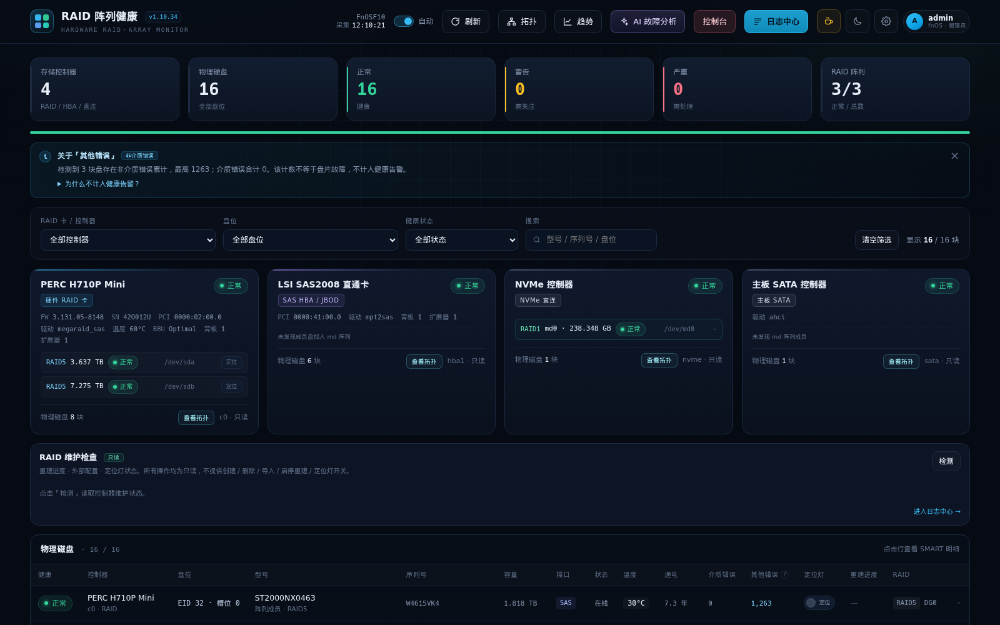
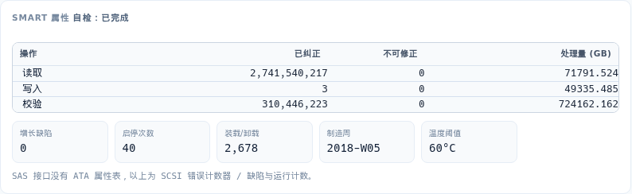
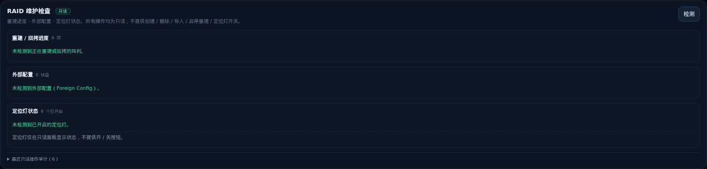
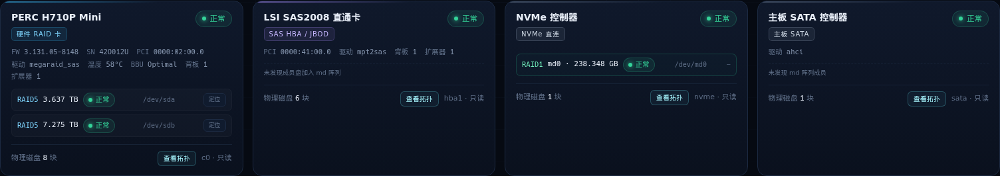
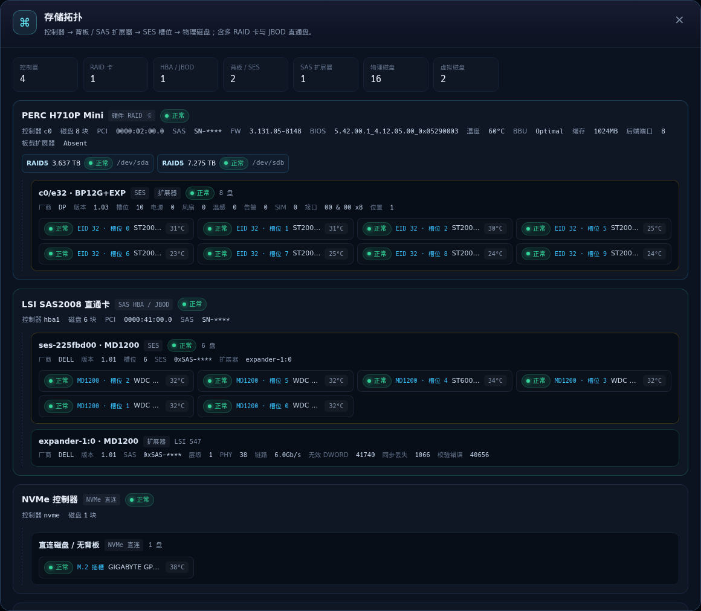
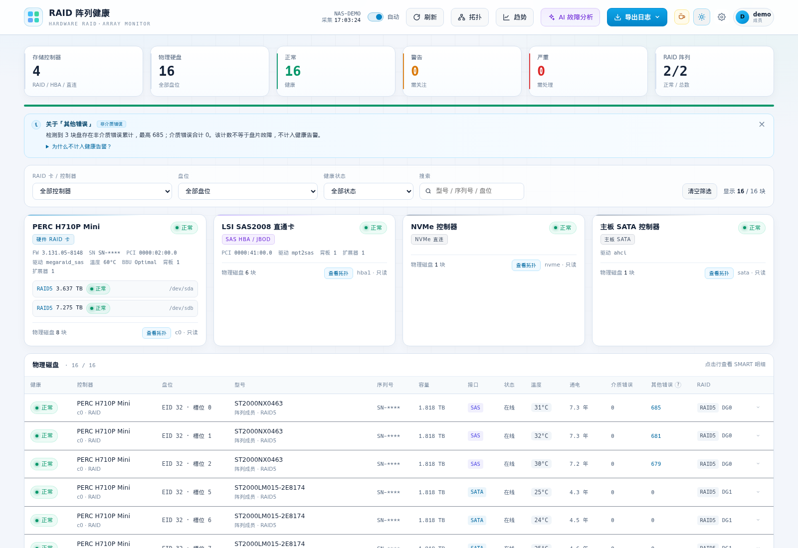
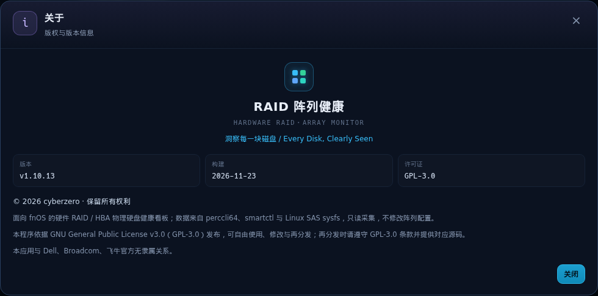
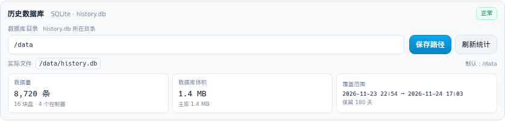
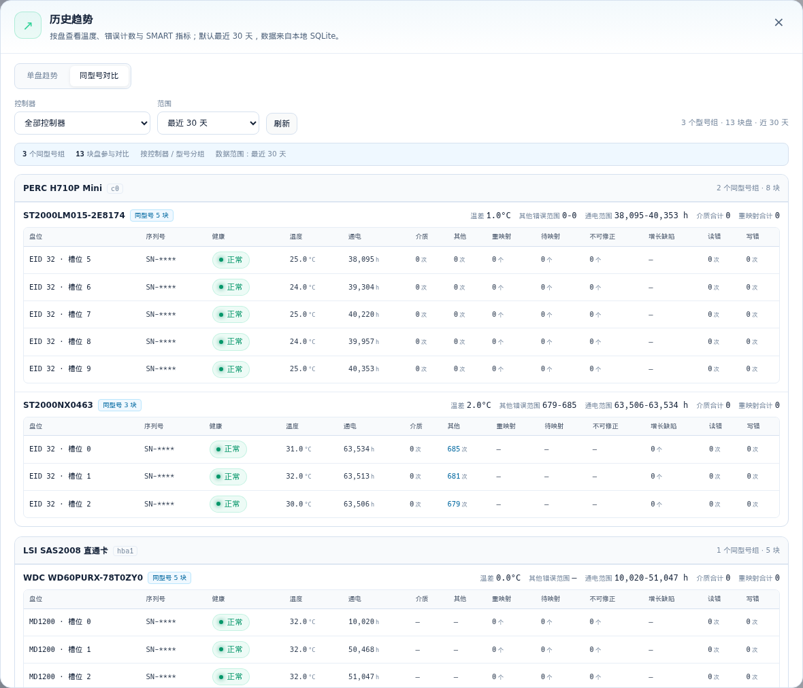

# RAID 阵列健康 · HARDWARE RAID・ARRAY MONITOR


给 fnOS（飞牛）在**硬件 RAID 卡**下的物理硬盘做一块可筛选、可导出的健康看板。

> 截图中的序列号、主机名、用户和数据库路径均已脱敏，仅用于展示界面。

当存储空间 1 / 2 建在 MegaRAID / PERC 卡上时，fnOS 只能看到 RAID 虚拟盘（`/dev/sda`、`/dev/sdb`），看不到卡后面的单块物理盘，也就无法提前发现某块盘的介质错误、重映射、温度异常。本页面通过 **perccli64** 读取 RAID 卡背板槽位与盘状态，再通过 **smartctl 的 MegaRAID 直通模式**逐块读取物理盘 SMART，把“卡后面的盘”完整展示出来。




亮色 SAS 表格：数字表头与数值右对齐，重要字段加宽。




## 功能

- **控制器总览**：RAID 卡 / HBA / NVMe / 主板 SATA / Linux 软 RAID（mdadm），展示型号、固件、序列号、PCI 地址、驱动与健康状态。
- **虚拟磁盘**：硬件 RAID 与 Linux mdadm 阵列的级别、容量、状态、`/dev/mdX` / `/dev/sdX`、成员盘。
- **物理硬盘明细**：盘位（EID:Slot）、厂商、型号、序列号、容量、接口、介质、温度、通电时间、介质错误、预测故障、SMART 告警、RAID 组。
- **SAS 优化**：厂商 / 型号统一 UTF-8 解码 + NFC；详情展示 SAS 协议（SPL）、链路速率、温度阈值，以及读 / 写 / 校验错误计数器、增长缺陷、启停 / 装载次数、制造周。
- **中文用户名**：fnOS 网关 `X-Trim-Username` 按 Latin-1 头解码后再还原 UTF-8，修复中文昵称乱码。
- **AI 故障分析**：支持 DeepSeek / OpenAI / Claude / Ollama 等 10 种供应商；分析异常盘、当前筛选或全部磁盘，一键导出 MD / TXT / JSON 报告。
- **后台设置（仅管理员）**：AI 接口地址、模型、API Key 只在「后台设置」中维护；API Key 为独立全宽字段，支持显示/隐藏与已保存状态；温度 / 最大输出 token 标注推荐范围并附调整说明。普通用户看不到入口，服务端同时校验 fnOS 管理员 Header。
- **历史趋势（SQLite）**：每次采集按盘写入 SQLite；默认查看最近 30 天，支持 7 / 30 / 90 天，按盘查看温度、错误计数与 SMART 指标曲线，并可导出 CSV。
- **趋势 / 健康合并卡片**：磁盘详情中的健康结论与温度等趋势图放在同一张卡片内，健康在上、趋势贴底，中间留白；可切换指标与 7 / 30 / 90 天范围。
- **存储拓扑**：控制器 → 背板 / SAS 扩展器 → SES 槽位 → 磁盘；支持多 RAID 卡、HBA / JBOD 直通盘，展示背板、扩展器、PHY、SAS 地址、链路错误计数与控制器温度 / BBU / BIOS / 缓存等参数。
- **版权 / 版本**：页脚展示应用名、版本与版权；「关于」弹窗展示版本、构建日期、GPL-3.0 许可证与版权声明。
- **亮色 / 暗色主题**：顶栏一键切换，`localStorage` 记忆选择；表格、趋势图、拓扑、AI / 关于弹窗同步适配。
- **历史数据库配置**：后台设置可修改 `history.db` 所在目录，显示采样条数、数据库体积、覆盖时间范围与 WAL 体积；路径持久化并在重启后继续生效。
- **RAID 只读维护检查**：管理员面板检测重建 / 回拷进度、外部配置（Foreign Config）和定位灯状态；只读、无写操作，并记录审计日志。
- **MD 阵列归属**：md 阵列只显示在直通卡 / HBA / NVMe / SATA 等直接控制器下；硬件 RAID 卡只显示自身虚拟盘，不再重复显示硬件 VD 上创建的 md 阵列；只读。
- **手机端维护检查**：小屏只显示一个「RAID 维护检查」按钮，展开后才显示维护面板和「检测」，收起后恢复单按钮。
- **手机端筛选面板**：小屏只显示一个「筛选」按钮，展开后显示控制器 / 盘位 / 状态 / 搜索；收起后保留筛选结果和活动条件数量。
- **手机端顶部菜单**：小屏只保留用户和展开按钮，其余操作收进下拉菜单，点击外部或 Esc 收起。
- **硬件控制台**：管理员菜单入口，首次创建 3 组单词安全码，通过后可执行硬件 RAID 创建 / 删除 / 扩容 / 初始化 / 重建 / 导入外部配置等写操作。
- **定位灯 / 重建进度列**：物理盘表格显示定位灯状态和重建进度；定位灯开关仅管理员可用，需输入 `LOCATE` 二次确认，并写入审计日志；其他写操作需通过硬件控制台。
- **日志中心**：`/logs` 独立页面，合并健康事件、数据导出与审计日志；审计日志标签仅管理员可见，普通用户只能查看事件和导出。
- **同型号对比**：趋势弹窗新增「同型号对比」标签，按控制器 / 型号分组，展示同型号盘的温度、通电、介质 / 其他错误、重映射 / 待映射等 SMART 指标差异；支持控制器筛选和 7 / 30 / 90 天范围。
- **筛选**：按 RAID 卡 / 控制器、盘位、健康状态筛选，支持型号 / 序列号 / 盘位搜索。
- **SMART 明细**：点击任意一行展开，健康结论与趋势图同卡片上下展示；下方「SMART 属性 / 自检」与「原始 SMART JSON」拆为两张独立卡片，左右对齐、间距 12px，窄屏自动上下堆叠。
- **非介质错误解释**：主表新增「其他错误」列并带帮助提示；检测到累计值时页面顶部显示蓝色信息条，说明其通常来自 SMART 直通轮询 / SAS 链路，不代表介质故障、不计入健康告警。
- **表格自适应**：SMART 属性表宽度撑满卡片内容区，左右留白一致；已纠正 / 处理量 / 原始值等重要字段加宽，数字表头与数值统一右对齐；桌面不出现横向滚动条，手机窄屏自动压缩列宽并对超长内容换行，亮色主题提高表头 / 正文字号与对比度。
- **SMART 双卡**：左卡为 SMART 属性 / 自检表，右卡为原始 JSON；两张卡片顶底对齐、宽度与间距同详情区其他卡片一致；左卡表格撑满卡片宽度并保持左右等距；右卡按钮加载原始数据并显示 `smartctl -a -j`，手机端自动上下布局。
- **导出日志**：CSV（Excel 直接打开，带 UTF-8 BOM）、JSON（完整结构化数据）、TXT（可读日志 + 健康变化事件）。导出范围跟随当前筛选条件。
- **后台采集 + 缓存**：默认每 120 秒刷新一次，首次加载不会阻塞页面；健康状态发生变化时写入 `data/events.jsonl`。
- **飞牛应用中心（FPK）**：已打包并安装，入口 `/app/diskhealth`，由 fnOS 统一网关校验登录；也支持 Docker 独立端口模式。
- **fnOS 单点登录**：复用 NAS 用户 / 2FA，不建立本地账号密码。
- **默认只读**：监控页面只执行 `perccli ... show` 与 `smartctl -a`；写操作必须通过管理员安全码控制台显式执行。

## 快速开始

### 方式一：飞牛应用中心（FPK，推荐）

安装包见 GitHub **v1.10.34 Releases** 附件 `diskhealth-v1.10.34.fpk`。在 fnOS 应用中心选择「手动安装」并选中该文件，或使用：

```bash
fnos-cli app install-fpk diskhealth-v1.10.34.fpk --volume-id 1 --yes
```

安装后从应用中心打开「RAID 阵列健康」。入口是 **`/app/diskhealth`**：fnOS 统一网关先校验登录态，再把请求转发到应用内的 Unix Socket，所以**打开即走 fnOS 登录，不需要在页面里再登录一次**。

- 应用以 root 运行（读取 RAID 卡 / 裸设备），只监听 `${TRIM_APPDEST}/app.sock`，**不开放 TCP 端口**。
- 启动、停止、重启由应用中心控制；数据保存在应用数据目录（`TRIM_PKGVAR`）。
- 应用图标会出现在应用中心，桌面图标由应用中心按设置自动创建。

重新打包：

```bash
cd disk-health
fnpack build -d fpk-src
# 输出 diskhealth.fpk
```

### 方式二：Docker 独立端口（开发 / 备用）

```bash
cd disk-health
docker compose up -d --build
# 或
./scripts/install.sh
```

默认端口 `18089`：

- `http://<NAS 内网 IP>:18089`
- 本机 `http://127.0.0.1:18089`

独立端口模式不在统一网关内，未登录会 302 到 fnOS `/signin` 并回调，会话保存在签名 Cookie 中（详见下一节）。

修改端口：

```bash
DISK_HEALTH_PORT=18090 ./scripts/install.sh
# 或
DISK_HEALTH_PORT=18090 docker compose up -d
```

## 登录鉴权（复用 fnOS 用户）

页面不维护账号密码，按运行模式复用 fnOS 登录态：

### FPK / 应用中心模式（默认）

- 入口 `/app/diskhealth` 由 fnOS **统一网关**先校验会话；未登录时由 fnOS 拦截，打开应用即走 fnOS 登录。
- 网关转发请求时注入可信 Header：`X-Trim-Userid`、`X-Trim-Username`、`X-Trim-Isadmin`。
- 应用只读取这些 Header，**不写登录 Cookie、不保存 Token**；右上角显示当前用户。
- 页面不提供“退出登录”，退出 fnOS 后网关自然失效。
- 应用只监听 `${TRIM_APPDEST}/app.sock`（Unix Socket），不开放 TCP 端口。

### Docker 独立端口模式（开发 / 备用）

该模式不在统一网关内，需要应用自己校验 fnOS 登录态：

1. **未登录**访问 `http://<NAS>:18089/` → 302 到 fnOS `/signin`，由 fnOS 完成账号密码 / 2FA / 安全访问码；登录成功后回跳 `/auth/callback`。
2. **已经登录过 fnOS** 的浏览器 → 服务端读取同主机的 `fnos-token`（新版为 `ost`）Cookie，调用 fnOS `oauthapi` 校验，不跳登录页。
3. 校验通过后只在签名 HttpOnly Cookie `dh_auth` 中保存 `uid / username / 是否管理员`（默认 12 小时），不保存密码和 fnOS token。

> **必须使用与 fnOS 相同的主机名 / IP 访问**（端口可以不同）。例如 fnOS 是 `http://192.168.1.100:5666`，本页就用 `http://192.168.1.100:18089`；不要混用 `localhost` 与 LAN IP，否则浏览器不会把 fnOS Cookie 发给本页。

```
浏览器 → 本页 :18089
   ├─ 已登录 fnOS：fnos-token Cookie → 服务端校验 → dh_auth
   └─ 未登录：302 /signin?... → 登录/授权 → /auth/callback?code → 换取身份 → dh_auth
```

首次授权时 fnOS 可能展示一次应用授权确认页；之后在 fnOS 登录态有效期内可直接进入。

如果自动回跳失败（例如 fnOS 侧限制了回调地址），访问 **`/login/code`**：按页面提示打开 fnOS 授权页，登录后复制页面显示的授权码并粘贴提交即可（与 fnos-cli 的公共客户端授权流程一致）。

#### 使用到的 fnOS 接口

| 接口 | 用途 |
| --- | --- |
| `POST /oauthapi/authorize` | 用浏览器 `fnos-token` 换取一次性授权码（无需跳转） |
| `POST /oauthapi/third-part/token` | 授权码 + PKCE `code_verifier` 换取 access token |
| `POST /oauthapi/userinfo` | 读取 uid / username / 管理员标记 |
| `GET /signin` | 未登录时跳转的 fnOS 登录页 |

默认复用 fnOS 官方 CLI 的公共 OAuth 客户端 `YJNMPJUGA9`（无 client_secret，PKCE），只申请 `trim.user.all`。如设备侧调整了客户端策略，可用 `FNOS_OAUTH_CLIENT_ID` 指定其他公共客户端。

#### HTTPS / 反向代理

- 页面与 fnOS 同域最顺：`https://nas.example.com:18089` + fnOS `https://nas.example.com:5667`。
- 设置 `FNOS_PUBLIC_URL=https://nas.example.com:5667`，让浏览器跳转到正确的 fnOS 地址；容器内部继续用 `FNOS_BASE_URL` 访问。
- 反代需传递 `X-Forwarded-Proto` / `X-Forwarded-Host`，否则回调地址会推导错误。
- fnOS Cookie 不带 Domain 且 `SameSite=Strict`，跨域名无法复用登录态；此时只能走 `/signin` OAuth 回跳，且回跳地址必须能被浏览器访问。

#### 退出

独立端口模式下，右上角用户胶囊的退出按钮只清除本页 `dh_auth`，**不会退出 fnOS 全局登录**。

## 为什么需要 root / privileged

读取 RAID 卡后的物理盘必须访问内核 MegaRAID ioctl 节点，并以 root 打开裸设备：

- `/dev/megaraid_sas_ioctl_node`
- `/dev/bus/N`（服务启动时按 `/sys/class/misc/megaraid_sas_ioctl_node/dev` 自动 `mknod`）
- `/dev/sdX`（直连 HBA / SATA / NVMe 盘）

两种运行方式：

- **FPK**：`config/privilege` 声明 `run-as=root`，由应用中心以 root 启动 `cmd/main`；服务只监听 `app.sock`，外部访问必须经过 fnOS 统一网关。
- **Docker**：`privileged: true` + 挂载 `/dev`，端口发布到宿主机。

无论哪种方式，**监控页面只执行 `perccli ... show` 与 `smartctl -a` 只读查询**；硬件写操作只能从管理员安全码控制台发起。

## 工作原理

```
浏览器 / 应用中心
   │  fnOS 统一网关 /app/diskhealth（校验登录，注入 X-Trim-Userid/Username/Isadmin）
   ▼
${TRIM_APPDEST}/app.sock  →  server.py（鉴权门禁 + 静态页 + JSON API + 日志导出）
                                │
                                ├─ collector.py ─┬─ perccli64 /c0 show J
                                │                ├─ /c0/eall/sall show all J
                                │                ├─ /c0/vall show all J
                                │                ├─ smartctl -d megaraid,<DID> -a -j /dev/bus/0
                                │                └─ smartctl /dev/sdX（HBA/SATA/NVMe）
                                └─ Monitor（后台 120s）→ 快照缓存 + 健康变化事件
```

- RAID 卡识别：`perccli64 show J` 枚举控制器；盘位来自 `EID:Slt`。
- 物理盘 SMART：`smartctl -d megaraid,<DID> -a -j /dev/bus/<控制器序号>`。
- HBA 直连盘：`lsblk` + sysfs 识别控制器与通道，`smartctl -a -j` 自动识别 SAS / SATA。
- 空槽位不会显示（perccli 不返回空槽），页面只呈现实际存在的磁盘。
- Docker 独立端口模式使用同一套采集代码，仅鉴权方式不同（见上一节）。

## 健康判定

| 级别 | 触发条件（满足任一） |
| --- | --- |
| **严重** | RAID 卡状态 `Offln / Failed / Msng`；SMART 自检失败；RAID 卡标记 SMART 告警；预测性故障计数 > 0；介质错误 > 0；温度 ≥ 临界值（HDD 58°C / SSD 75°C / NVMe 80°C）；NVMe 介质错误 > 0 |
| **警告** | 阵列重建 / 回拷 / 降级；温度偏高（HDD 50°C / SSD 65°C / NVMe 70°C）；重映射 / 待映射 / 不可修正扇区 > 0；SAS 增长缺陷 > 0；NVMe 寿命已用 ≥ 90% |
| **未知** | 直连盘无法读取 SMART（休眠、权限、设备异常） |
| **正常** | 以上均未触发 |

RAID 卡状态、SMART 自检结果、介质错误计数三者同时展示，避免单一口径误判。控制器 `Other Error Count` 会被 SMART 直通查询累加，仅作为提示展示，不参与告警。

SAS 盘没有 ATA 属性表，详情页改为展示 SCSI 错误计数器与缺陷/运行计数：


## 页面使用

1. 顶部 KPI 查看控制器 / 物理盘 / 正常 / 警告 / 严重 / 阵列健康数量。
2. 点击控制器卡片可按该卡筛选；盘位下拉会随控制器联动。
3. 点击表格行展开 SMART 明细；健康结论与趋势图同卡片，SMART 属性表与原始 JSON 分为左右两张卡；“查看原始 SMART JSON”会在右卡实时执行一次 `smartctl -a -j`。
4. “导出日志”按当前筛选导出 CSV / JSON / TXT。
5. 右上角可暂停“自动”（每 30 秒获取快照）；“刷新”会触发一次立即采集（约 10–40 秒）。
6. 右上角用户胶囊显示当前 fnOS 用户与角色。FPK 模式不提供退出（退出 fnOS 即失效）；Docker 模式点右侧退出图标只清除本页登录态。
7. **管理员**额外可见右上角齿轮「后台设置」，用于配置 AI 接口；普通用户没有该入口。
8. 「AI 故障分析」按异常盘 / 当前筛选 / 全部盘生成诊断报告，分析完成后可一键导出。
9. 「拓扑」查看控制器 → 背板 / SAS 扩展器 → SES 槽位 → 磁盘的完整树状结构；控制器卡片上的「查看拓扑」可只看单张卡。

## 非介质错误（Other Error Count）

「其他错误」不是介质错误，也不代表硬盘正在损坏。页面现在：

- 主表新增「其他错误」列，数字带 `?` 帮助提示
- 检测到非介质错误累计时，页面顶部显示蓝色信息条，列出受影响盘数、最高值、介质错误合计
- 信息条可展开「为什么不计入健康告警？」并支持关闭
- 磁盘详情中显示「其他错误（非介质）」，并附一行说明
- 健康原因文案改为：  
  `非介质错误计数 N：通常由 SMART 直通轮询 / SAS 链路累计，不代表介质故障，不计入健康告警`


磁盘详情：


### 判定原则

- `Media Error Count`、预测故障、SMART 重映射 / 待映射 / 增长缺陷等才会进入健康告警
- `Other Error Count` 是 PD 级非介质累计，可能由 SMART 直通查询、SAS 链路、控制器轮询产生
- 如果应用停止后计数不再增长，通常是轮询副作用；若持续跳增并伴随事件日志报错，再检查背板 / 线缆 / 控制器

## RAID 只读维护检查（管理员）

主页面新增管理员专用「RAID 维护检查」面板：

- 检测 RAID 重建 / 回拷进度
- 检测外部配置（Foreign Config）
- 显示定位灯状态
- 所有读操作需管理员权限；普通用户不可见，直接请求 API 返回 403
- 每次检测写入 `data/audit.jsonl`，记录用户、时间、动作、结果
- **不提供创建 / 删除阵列 / 导入外部配置 / 启停重建**



## 硬件控制台（读写，实验性）

控制台写操作属于**实验性功能**。页面会显示风险提示，首次进入必须勾选风险确认；误操作可能造成数据丢失、阵列不可用或系统无法启动。

菜单栏「控制台」仅管理员可见：

- 第一次打开：创建 3 组单词安全码；之后只登录，不会重复创建
- 安全码使用 PBKDF2 哈希保存，权限 `0600`，不保存明文
- 登录后签发 30 分钟内存 Token
- 失败 5 次锁定 10 分钟
- 每个写操作需要输入精确确认短语
- 支持操作：
  - 创建 RAID 虚拟盘
  - 删除虚拟盘
  - 扩容虚拟盘：必须先选择符合条件的新盘（同控制器、未加入阵列、Unconfigured Good、容量不小于现有成员盘），没有空闲盘时页面明确提示
  - 快速 / 全盘初始化
  - 开始重建
  - 导入外部配置
- 仅硬件 RAID 控制器可执行写操作；HBA 直通卡不提供阵列写操作

**警告：控制台会直接修改 RAID 配置并可能造成数据丢失。首次创建安全码后请妥善保存。**

### 忘记安全码

控制台**不提供在线重置入口**。忘记安全码时，只能由拥有 SSH 权限的管理员操作：

```bash
sudo rm -f /usr/local/apps/@appdata/diskhealth/data/console_security.json
sudo fnos-cli app restart diskhealth --yes
```

重启会使现有控制台 Token 失效。重新打开控制台后创建新的 3 组单词安全码。

## 定位灯控制（唯一常规写操作）

管理员可在物理盘行、硬件 RAID 虚拟盘行、软 RAID 阵列行点击「定位」：

- 定位灯闪烁 30 秒后由服务端自动停止
- 按钮变为「停止定位」，再次点击立即取消
- 启动需要输入 `LOCATE` 二次确认
- 停止无需再次确认
- 普通用户看不到按钮
- 所有启动、停止、自动停止均写入审计日志

支持目标：

- 硬件 RAID 物理盘
- 硬件 RAID 虚拟盘（定位全部成员盘）
- 有硬件成员盘的 mdadm 软 RAID 阵列
- NVMe 等没有可控硬件定位灯的成员显示 `—`，不提供按钮

## 日志中心

独立页面 `/logs` 合并三类日志：

- **健康事件**：最近 200 条健康变化
- **数据导出**：CSV / JSON / TXT
- **审计日志**：仅管理员可见，支持按用户、动作、结果、日期和关键词筛选

普通用户可查看健康事件和数据导出，但看不到审计标签；直接访问审计 API 返回 403，旧 `/audit` 路径仅对管理员重定向到日志中心。


## Linux 软 RAID（mdadm）

自动读取 `/proc/mdstat` 与 `/sys/block/md*`，把 Linux 软 RAID 阵列并入其成员盘所属的直通控制器卡片；硬件 RAID 卡不显示 md 阵列：

- 阵列级别（RAID0/1/4/5/6/10、linear）
- 阵列容量、状态、UUID、metadata 版本
- 成员分区与状态
- 降级 / 重建 / 同步进度
- 阵列显示在直通卡 / HBA / NVMe / SATA 控制器卡片内
- 硬件 RAID 卡只保留硬件 RAID 虚拟盘，不重复显示硬件 VD 上的 md 阵列
- 成员盘在物理盘表的 RAID 列显示 `mdX RAID` 标签
- 软 RAID 只读，不提供创建 / 停止 / 移除 / 重建操作



## AI 故障分析

顶部「AI 故障分析」会读取当前磁盘健康 / SMART 数据，交给管理员配置的 AI 接口诊断。分析范围支持：

- **异常磁盘**：只分析 warning / critical / unknown 的盘；
- **当前筛选**：把页面上筛选后的磁盘发给 AI；
- **全部磁盘**：整体体检。

输出为 Markdown，页面内渲染；分析完成后可 **一键导出 MD / TXT / JSON**（报告按用户隔离，普通用户只能导出自己的报告）。


### 支持的 AI 供应商

| 供应商 | 默认接口 | 默认模型 |
| --- | --- | --- |
| DeepSeek | `https://api.deepseek.com/v1` | `deepseek-chat` |
| OpenAI | `https://api.openai.com/v1` | `gpt-4o-mini` |
| Moonshot / Kimi | `https://api.moonshot.cn/v1` | `moonshot-v1-8k` |
| 智谱 GLM | `https://open.bigmodel.cn/api/paas/v4` | `glm-4-flash` |
| 阿里云百炼 / 通义 | `https://dashscope.aliyuncs.com/compatible-mode/v1` | `qwen-plus` |
| 硅基流动 | `https://api.siliconflow.cn/v1` | `deepseek-ai/DeepSeek-V3` |
| OpenRouter | `https://openrouter.ai/api/v1` | `deepseek/deepseek-chat` |
| Anthropic Claude | `https://api.anthropic.com/v1` | `claude-3-5-sonnet-20241022` |
| Ollama（本地） | `http://127.0.0.1:11434/v1` | 按本机 `ollama list` 选择，如 `qwen3:8b-64k` |
| 自定义 | 任意 OpenAI 兼容地址 | 任意模型 |

接口地址、模型、温度、最大 token 都可修改；保存前可「测试连接」。

**Ollama 说明：**

- 接口地址填 `http://127.0.0.1:11434/v1`，模型必须是本机已安装的 tag
- 应用会对 Ollama 使用原生 `/api/chat` 并关闭 thinking，避免 Qwen3 等思考模型把输出预算耗在 `reasoning` 上
- 连接测试使用 512 token 预算；完整 16 盘分析在 8B 本地模型上约需 2–3 分钟，请求超时默认/当前为 300 秒
- 当前推荐配置：温度 `0.2`，最大输出 token `3000`；若只追求速度可换 `qwen3.5:4b-64k`

### 后台设置（仅管理员）

右上角 **齿轮图标 → 后台设置** 只对 fnOS 管理员显示：

- 服务端通过网关 `X-Trim-Isadmin` / 独立模式 fnOS 用户信息判断管理员；普通用户即使构造 `/api/admin/ai` 请求也会返回 **403**。
- 普通用户的 AI 弹窗只有「分析范围 / 开始分析 / 导出」，没有接口地址、模型、API Key 设置。
- API Key 以 `0600` 权限保存在应用数据目录的 `ai_config.json`，不会回传前端。
- API Key 为独立全宽字段，支持「显示 / 隐藏」切换，并显示「已保存 / 未配置」状态；亮色 / 暗色主题均已适配。
- 温度：推荐 `0.1–0.3`，越低越稳定、越可复现，适合故障诊断；过高会让结论发散。
- 最大输出 token：推荐 `1800–3000`，只限制单次回复长度，不是固定扣费；过短可能截断报告，过长会增加等待。
- 更换供应商时不会把旧 Key 发送到新接口；可勾选「清除已保存的 Key」。
- 序列号默认脱敏（只保留前 4 位），可在后台关闭脱敏。


API Key 字段（亮色主题）：


### 数据与隐私

- 分析时会向所选 AI 服务商发送：主机名、控制器 / RAID 状态、盘位、型号、健康结论、温度、错误计数和 SMART 关键指标。
- 默认不发送完整序列号；报告只保存在本机，导出由用户主动触发。
- AI 调用由服务端发起，API Key 不会进入浏览器请求或页面源码。

## 控制器 / 背板 / JBOD 拓扑

### 控制器参数

MegaRAID / PERC 控制器会额外读取 `show all`：

- 型号、序列号、SAS 地址、PCI 地址、固件包 / 固件版本、BIOS、Ctrl-R、NVDATA、Bootloader
- 驱动、Host / Device Interface、前后端端口数、板载内存 / Flash / NVRAM / CacheVault
- ROC / 控制器温度、BBU 型号 / 状态 / 温度 / 保持时间
- 内存可纠正 / 不可纠正错误、ECC Bucket、控制器状态、缓存保留、Safe Mode
- 自动重建、电池告警、Coercion、RAID 能力与定时一致性检查 / Patrol Read

### 背板 / 扩展器 / SES

- RAID 卡通过 `perccli /cN/eall show all` 读取 Enclosure / SES 信息：EID、设备类型、SES 类型、厂商、产品、版本、FRU、序列号、槽位、磁盘数、电源、风扇、温感、告警、连接器。
- HBA / JBOD 直通盘通过 Linux `/sys/class/sas_*` 读取：SAS Host → Expander → PHY → End Device → Block Device。
- 展示扩展器厂商 / 产品 / 版本 / 组件 ID / SAS 地址 / PHY 数 / 链路速率，以及无效 DWORD、同步丢失、校验错误等计数器。
- 磁盘补充 SES `enclosure_identifier`、`bay_identifier`、SAS 地址、PHY、链路速率和扩展器归属。

多张 RAID 卡按 `c0`、`c1`… 独立采集；HBA / JBOD 直通盘按 `hba1` 等控制器归组；NVMe / SATA 作为直连控制器展示。顶部「拓扑」入口或控制器卡片「查看拓扑」可打开完整树状视图。



AI 分析会同时发送控制器参数、背板 / 扩展器、SES 槽位和磁盘拓扑，便于判断“单盘故障、背板 / 扩展器链路问题或 RAID 卡问题”。

## 亮色 / 暗色主题

顶栏太阳 / 月亮按钮切换主题：

- 默认暗色，切换后写入 `localStorage`（`disk-health-theme`），刷新后保留
- `theme.js` 在 CSS 前执行，避免刷新时先闪暗色
- 表格、趋势图坐标 / 网格、拓扑树、AI 报告、原始 JSON、全部弹窗与表单同步换色
- 主题切换时会重绘已打开的完整趋势图和详情内嵌趋势图
- 窄屏布局不变，仅切换配色




## 版权与许可证

- 开发 / 版权：**cyberzero**
- 页脚、设置页底部、关于弹窗统一显示 `© 2026 cyberzero`
- 页脚开发者信息旁展示 **GPL-3.0**，可点击查看许可证
- 许可证：**GNU General Public License v3.0 or later（GPL-3.0-or-later）**

### GPL-3.0 分发与源码

本项目原创代码以 **GPL-3.0-or-later** 分发，允许自由使用、修改和再分发；再分发二进制时须遵守 GPL-3.0 条款并提供对应源码。

- 完整许可证：[LICENSE](LICENSE)
- 标准 GPL 全文：[COPYING](COPYING)
- GitHub 源码：<https://github.com/magicindex/fnos-diskhealth>
- 应用内许可证入口：设置页底部「GPL-3.0 许可证说明」或 `/api/license`
- 本程序不提供任何明示或默示担保
- 随包 `perccli64` / `smartctl` 等第三方工具保留各自许可证

页脚信息：


## 关于 / 版权版本

页脚新增：

- 应用名 `RAID 阵列健康`
- 当前版本 `v1.10.34`
- `© 2026 cyberzero`
- 「关于」入口

「关于」弹窗展示版本、构建日期、GPL-3.0 许可证、版权声明、数据源与免责声明。本应用与 Dell、Broadcom、飞牛官方均无隶属关系。



版本号来自 FPK 启动环境 `APP_VERSION`，构建日期来自 `APP_BUILD`；修改版本时同步更新 `manifest`、`cmd/main` 与页面默认值。

## 历史趋势（SQLite）

每次后台采集（默认每 120 秒）会把每块盘的采样写入应用数据目录的 `history.db`：

- 默认读取 **最近 30 天**，可切换 7 / 30 / 90 天；
- 支持按盘查看：温度、介质错误、其他错误、预测故障、重映射 / 待映射 / 不可修正扇区、SAS 增长缺陷、读写不可修正、通电时间；
- 磁盘行展开后，健康结论卡片下方直接显示趋势图；可切换指标与 7 / 30 / 90 天；
- 趋势卡片右上角「全屏」打开大图，顶栏「趋势」也可进入；
- 图表使用 Canvas 绘制，悬停显示时间与数值；支持导出当前曲线 CSV；
- 默认保留 **180 天**（`HISTORY_RETENTION_DAYS`），SQLite 使用 WAL 模式，文件权限 0600。


全屏趋势：


> 历史从应用部署后开始积累，不会回填安装之前的数据；刚安装时曲线点较少，运行一段时间后自动形成 30 天趋势。

### 历史数据库路径与容量

后台设置新增「历史数据库」区域（仅管理员）：

- 可配置 `history.db` 所在目录，填写完整文件路径时会自动取其所在目录
- 显示实际文件路径
- 显示采样条数、覆盖磁盘 / 控制器数量
- 显示数据库体积，含主库 / WAL 体积
- 显示数据覆盖时间范围与保留天数
- 路径保存到 `db_config.json`，重启后继续使用；原数据库文件不会自动移动
- 提供「保存路径」和「刷新统计」



### 同型号对比

趋势弹窗新增「同型号对比」标签，用于横向检查同一控制器下同型号磁盘的 SMART 差异：

- 先按控制器分组，再按型号分组，只展示同型号且 ≥2 块的磁盘
- 表格展示温度、通电时间、介质错误、其他错误、重映射、待映射、不可修正、SAS 增长缺陷、读写不可修正
- 每组顶部显示温差、其他错误范围、通电范围、介质 / 重映射合计
- 支持控制器筛选和最近 7 / 30 / 90 天范围
- 数据来自本地 SQLite 历史快照，提供当前值与范围 min–max
- 单盘趋势和同型号对比互不影响，可在弹窗内切换



## API

- **FPK 模式**：网关先校验 fnOS 登录，并注入 `X-Trim-*` Header；应用只信任这些 Header。
- **Docker 模式**：除 `/api/health` 外要求 `dh_auth` 会话；未登录 API 返回 401，HTML 302 到 fnOS 登录页。

| 方法 | 路径 | 说明 |
| --- | --- | --- |
| GET | `/api/disks` | 当前快照（采集未完成返回 202）；`?refresh=1` 触发刷新 |
| GET | `/api/status` | 采集状态、上次采集时间、错误 |
| GET | `/api/refresh` / POST | 触发立即采集 |
| GET | `/api/disk?id=<id>` | 单盘详情 + smartctl 原始 JSON |
| GET | `/api/events?limit=200` | 健康变化事件 |
| GET | `/api/export?format=csv\|json\|txt` | 导出；支持 `controller`、`bay`、`health`、`q` |
| GET | `/api/session` | 当前 fnOS 用户、运行模式、是否可退出、版权 / 版本元数据 |
| GET | `/api/topology` | 完整控制器 / 背板 / 扩展器 / 磁盘拓扑 |
| GET | `/api/history/disks?days=30` | 有历史采样的磁盘列表与指标列表 |
| GET | `/api/history/series?disk_id=&metric=&days=30` | 单盘指标序列（默认 720 点降采样） |
| GET | `/api/history/export?disk_id=&metric=&days=30` | 导出趋势 CSV |
| GET | `/api/history/compare?days=30` | 同型号对比：各盘最新值与范围内 min/max/avg |
| GET | `/api/admin/db` | **仅管理员**：数据库路径、体积、采样量 |
| POST | `/api/admin/db` | **仅管理员**：保存 `history.db` 所在目录 |
| GET | `/api/ai/status` | AI 是否已配置（不返回接口地址 / Key） |
| POST | `/api/ai/analyze` | AI 故障分析（scope=issues/all/ids） |
| GET | `/api/ai/report` / `/api/ai/reports` | 读取报告（仅本人或管理员） |
| GET | `/api/ai/export?id=&format=md\|txt\|json` | 一键导出 AI 报告 |
| GET/POST | `/api/admin/ai` | **仅管理员**：读取 / 保存 AI 接口设置 |
| POST | `/api/admin/ai/test` | **仅管理员**：测试 AI 连接 |
| POST | `/api/logout` | 仅独立端口模式：清除本页会话 |
| GET | `/api/health` | 公开健康检查 |

磁盘 `id` 形如 `c0.e32.s0`（RAID：控制器.机框.槽位）、`hba1.CH0`、`sata.SATA5`、`nvme.M.2`。

## 配置

| 环境变量 | 默认值 | 说明 |
| --- | --- | --- |
| `PORT` | `8080` | Docker 模式监听端口 |
| `AUTH_MODE` | `cookie` | `gateway`（FPK）或 `cookie`（Docker） |
| `DISKHEALTH_GATEWAY_SOCKET` | 空 | FPK 模式下监听的 Unix Socket 绝对路径 |
| `APP_BASE_PATH` | 空 | 网关前缀，如 `/app/diskhealth` |
| `DISK_HEALTH_PORT` | `18089` | 宿主机映射端口（compose / install.sh） |
| `REFRESH_INTERVAL` | `120` | 后台采集间隔（秒，最小 30） |
| `SMART_WORKERS` | `6` | 并行读取 SMART 的线程数 |
| `TZ` | `Asia/Shanghai` | 页面与日志时区 |
| `DATA_DIR` | `/data` | 快照缓存与事件日志目录（FPK 为 `${TRIM_PKGVAR}/data`） |
| `PERCCLI_PATH` | `/usr/local/bin/perccli64` | perccli 路径 |
| `SMARTCTL_PATH` | 自动查找 | smartctl 路径 |
| `FNOS_BASE_URL` | `http://host.docker.internal:5666` | 容器内访问 fnOS 的地址 |
| `FNOS_PUBLIC_URL` | 自动推导 | 浏览器访问 fnOS 的 origin，如 `https://nas:5667` |
| `FNOS_OAUTH_CLIENT_ID` | `YJNMPJUGA9` | fnOS 公共 OAuth 客户端 |
| `FNOS_OAUTH_SCOPE` | `trim.user.all` | 申请的身份权限 |
| `SESSION_TTL` | `43200` | 本页登录会话有效期（秒） |
| `FNOS_AUTH_TIMEOUT` | `8` | 调用 fnOS 鉴权接口超时（秒） |
| `FNOS_INSECURE_TLS` | `0` | 访问自签 HTTPS 时设为 `1` |
| `AI_INSECURE_TLS` | `0` | AI 接口使用自签 HTTPS 时设为 `1` |
| `AI_DATA_DIR` | 同 `DATA_DIR` | AI 配置与报告目录 |
| `HISTORY_RETENTION_DAYS` | `180` | SQLite 历史保留天数 |
| `APP_VERSION` | `1.10.34` | 页脚 / 关于弹窗显示的应用版本 |
| `APP_BUILD` | `2026-11-23` | 页脚 / 关于弹窗显示的构建日期 |

`data/` 下会生成：

- `last_snapshot.json`：最近一次快照（重启后先显示，避免白屏）
- `events.jsonl`：健康状态变化事件（最多保留最近 800 条在内存，文件追加）
- `history.db`：SQLite 历史采样（默认保留 180 天，WAL 模式）
- `ai_config.json`：AI 接口配置（0600，仅管理员 API 可读写）
- `ai_reports.jsonl` / `ai_reports/`：AI 诊断报告（按用户隔离）

## 目录结构

```
disk-health/
├── diskhealth-v1.10.34.fpk  # 本地打包产物，不提交仓库；见 Releases
├── fpk-src/             # FPK 源：manifest / ui/config / cmd / icons
│   ├── manifest
│   ├── app/             # 安装到 ${TRIM_APPDEST} 的代码与静态资源
│   ├── cmd/main         # start / stop / status（root）
│   └── config/privilege # run-as=root
├── app/                 # Docker / 独立端口源码
│   ├── ai.py            # AI 供应商适配 / 提示词 / 报告
│   ├── history.py       # SQLite 历史采样 / 趋势查询 / CSV
│   ├── sas.py           # HBA / JBOD 的 SAS sysfs 拓扑（扩展器 / SES）
│   ├── auth.py          # fnOS 登录 / OAuth / 会话签名
│   ├── server.py        # HTTP / Unix Socket 服务、鉴权门禁与 API
│   ├── collector.py     # 采集编排、后台刷新、事件
│   ├── raid.py          # perccli64 解析
│   ├── inventory.py     # HBA / SATA / NVMe 直连盘
│   ├── smart.py         # smartctl 封装与归一化
│   ├── health.py        # 健康评级
│   ├── export.py        # CSV / JSON / TXT
│   └── static/          # index.html / app.js / style.css
├── bin/perccli64        # Dell PERC 版 StorCLI（静态二进制，只读查询）
├── scripts/install.sh
├── tests/               # 解析 / 健康 / 导出 / 鉴权测试
├── Dockerfile
├── docker-compose.yml
└── data/                # Docker 模式运行时生成
```

运行测试：

```bash
cd disk-health
PYTHONPATH=app python3 -m unittest discover -s tests -v
```

## 常见问题

**应用中心打开显示 “invalid token”**
统一网关没有拿到 fnOS 登录 Cookie。先在同一个浏览器里登录 fnOS（`http://<NAS>:5666`），再从应用中心打开；确认应用在运行：`fnos-cli app status diskhealth`。不要用 `localhost` 登录 fnOS、再用 LAN IP 打开应用。

**FPK 启动失败 / 应用中心显示已停止**
查看日志 `应用数据目录/server.log`；确认 `/usr/bin/python3` 与 `/usr/sbin/smartctl` 存在，`/dev/megaraid_sas_ioctl_node` 可访问。可手动重试：`fnos-cli app start diskhealth --yes`。

**页面一直显示“正在采集”**
首次采集要逐块盘读 SMART，RAID 后的 SATA 盘可能单块就要几秒。FPK 看 `server.log`，Docker 看 `docker logs -f disk-health`；超过 2 分钟仍未完成，检查 `perccli64` 与 `/dev/bus/0` 是否可用。

**控制器数量为 0 / 看不到 RAID 卡**
本机是 LSI/Broadcom MegaRAID、Dell PERC。`perccli64` 仅支持这类卡；其他品牌（Adaptec / Areca / HighPoint）需要替换采集命令。确认 FPK 以 root 运行（`config/privilege`）或 Docker 以 privileged 运行，且 `/dev/megaraid_sas_ioctl_node` 存在。

**SMART 为空或“休眠状态”**
直连盘使用 `-n standby` 避免唤醒休眠盘；处于休眠时会标记为未知。RAID 卡后的盘不经过该保护。若所有盘都读不到，检查 `/dev/bus/N` 的 major 是否与 `/sys/class/misc/megaraid_sas_ioctl_node/dev` 一致（容器启动时会自动按该值创建）。

**HBA 盘的“盘位”为什么是 CH0–CH5**
SAS HBA 直通没有 RAID 卡的 EID:Slot 概念，显示的是控制器通道号；RAID 卡上的盘才是真实机框槽位（如 `EID 32 · 槽位 0`）。

**空盘位为什么没有**
perccli 只返回已安装磁盘。若需要空槽位占位，可按机框规格扩展，但不同背板差异大，当前不虚构空槽。

**Docker 模式一直跳转 fnOS 登录页**
确认浏览器地址与 fnOS 是同一主机（端口可不同），例如都用 `192.168.1.100`；确认容器能访问 `http://host.docker.internal:5666`（`docker exec disk-health python3 -c "import urllib.request;print(urllib.request.urlopen('http://host.docker.internal:5666/api/health').status)"`）；若 fnOS 改过端口，同步修改 `FNOS_BASE_URL`。

**登录后提示“无法连接 fnOS 认证服务”**
容器到 fnOS Web 服务不通：检查 `FNOS_BASE_URL`、fnOS 是否监听 5666、Docker 是否带 `--add-host=host.docker.internal:host-gateway`。

**登录后提示“授权码兑换失败 / invalid code”**
授权码一次性且 5 分钟有效，重复刷新回调页会失败；回到 `/` 重新登录即可。若持续失败，检查系统时间与 fnOS 版本。

**HTTPS 下登录后又跳回登录页**
页面与 fnOS 需同为 HTTPS；设置 `FNOS_PUBLIC_URL`，并确保反代传递 `X-Forwarded-Proto: https`，否则签名 Cookie 的 `Secure` 标记与回调地址会不一致。

**本地 FPK 升级**
应用中心对本地 FPK 的覆盖安装可能返回 `10236`；升级时先 `fnos-cli app uninstall diskhealth --yes`，再安装新版本。卸载会清理应用数据。

**用户名显示乱码**
已对网关 Header 做 Latin-1 → UTF-8、百分号解码和 NFC 归一化；如果个别昵称仍异常，请把 `X-Trim-Username` 原始值反馈给我。

**SAS 盘链路速率显示 —**
PERC 直通盘的速率由 perccli 的 `Link Speed` 提供；HBA 直连盘由背板/扩展器上报，MD1200 等背板可能返回 `Unknown`，此时显示 `—`，属于背板限制，不是读取失败。

**普通用户看不到「后台设置」**
这是预期行为：只有 fnOS 管理员（网关 `X-Trim-Isadmin=true`）会显示齿轮入口，`/api/admin/ai` 也会返回 403。请让管理员登录后配置 AI 接口。

**AI 未配置 / 无法分析**
请管理员打开右上角齿轮 → 后台设置，选择供应商、填写接口地址、模型和 API Key，点击「测试连接」成功后再保存。

**AI 连接失败 401 / 403**
检查 API Key 是否正确、是否选择了对应供应商、模型名是否存在；自定义接口需兼容 OpenAI `POST /chat/completions`。

**导出 CSV 中文乱码**
文件带 UTF-8 BOM，Excel 可直接打开；若用其他工具请按 UTF-8 读取。

**Docker 容器主机名显示为容器 ID**
已在 compose 中设置 `uts: host`（安装脚本带 `--uts=host`），页面显示 fnOS 主机名。手动 `docker run` 时请保留该参数。

## 安全与限制

- **FPK 模式**：登录由 fnOS 统一网关完成，应用读取 `X-Trim-*` Header；不保存密码、不写登录 Cookie。只监听 `app.sock`，Socket 权限 0666 以便网关连接，本机其他用户也可连接该 Socket；读写控制台仅管理员可用，并要求 3 组单词安全码。
- **Docker 模式**：不存储密码；只把 uid / username / 管理员标记写入 HMAC 签名、HttpOnly、SameSite=Lax 的 `dh_auth` Cookie。`auth_secret` 保存在 `data/auth_secret`（0600），删除后所有会话失效。
- FPK 以 **root** 运行（读取 RAID 卡 / 裸设备），请确认接受该权限模型；监控默认只读，读写控制台中的创建 / 删除 / 扩容 / 初始化 / 重建 / 导入外部配置会直接修改 RAID。Docker 模式则使用 `privileged`。
- 页面响应带 CSP、`X-Frame-Options`、`Cache-Control: no-store`。FPK 需要被应用中心 iframe 嵌入，因此使用 `SAMEORIGIN`；独立端口模式使用 `DENY`。
- 历史采样保存在 `history.db`（0600，SQLite WAL），默认保留 180 天；普通登录用户可查看趋势。
- AI 接口设置只有管理员可读写；普通用户无法看到后台入口，API 也会校验管理员 Header。
- AI API Key 以 `0600` 保存在本机 `ai_config.json`，不会回传前端；调用日志不记录 Key。
- AI 分析会把磁盘健康数据发送到所选服务商；默认脱敏序列号，可在后台关闭。
- 同一 fnOS 用户可查看全部磁盘；如需仅管理员可见，可在 `server.py` 中按 `user["admin"]` 增加限制。
- 健康阈值是通用经验值（企业盘 / 监控盘可自行调整 `app/health.py`）。
- 目前只验证了 Dell PERC H710P Mini（MegaRAID SAS 2208）与 LSI SAS2008 HBA；其他 MegaRAID 型号一般可直接复用 perccli。

## 卸载

FPK：

```bash
fnos-cli app uninstall diskhealth --yes
# 或在应用中心里卸载
```

Docker：

```bash
docker rm -f disk-health
docker rmi disk-health:1.0.0
```

FPK 的应用数据随卸载由应用中心清理；Docker 的 `data/` 可自行保留或删除。
